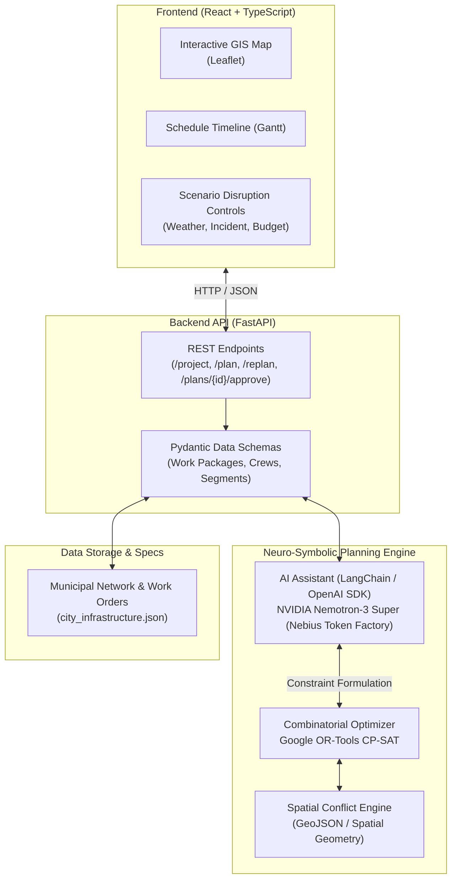

# InfraSync: Civil Infrastructure Sequencing & Adaptive Planning Copilot

[](https://opensource.org/licenses/MIT)
[](https://www.python.org/)
[](https://fastapi.tiangolo.com/)
[](https://react.dev/)
[](https://developers.google.com/optimization)
[](https://tokenfactory.nebius.com)

> **Multi-utility construction sequencing and disruption adaptation: a deterministic optimizer (Google OR-Tools) proposes the plan, an AI copilot (NVIDIA Nemotron via Nebius Token Factory) translates and explains it, and a human approves.**

> **🚧 Project status (2026-10-23): early build.** The backend (FastAPI) and frontend (React + Vite) **scaffolds are in place** and communicate over a stub `/project` endpoint. The optimizer, AI copilot, map, and timeline are **planned next** — see [`docs/FeatureSet.md`](docs/FeatureSet.md) for the full feature set, implementation plan, and open decisions. Sections below describe the **target** system; Repository Structure (§6) marks what exists today vs. what is planned.

---

## 1. Executive Summary & Problem Statement

Uncoordinated street works are one of the most visible and costly failures in public infrastructure, and the waste starts **inside a single owner's own portfolio** before it ever involves outside parties:

* **Within one owner.** A city's roads, water, drainage and sewer departments plan in separate systems and separate budget cycles. The city repaves a corridor, then months later excavates the same asphalt to replace a water main, then opens it again for drainage — all projects it *already owns*, simply never sequenced together.
* **Across owners.** The same street is later re-opened by a private telecom for fiber, because utility and municipal plans are never compared against each other.
* **Tooling gap.** Legacy suites (Oracle Primavera P6, Microsoft Project) optimize *one project at a time* and operate in departmental silos. Existing "Dig Once" portals (e.g., Michigan's statewide portal, London's Infrastructure Mapping Application) only *flag* geographic overlaps on a map — they do not optimize a joint schedule or quantify the trade-off.
* **Why not a pure LLM.** Language models cannot reliably solve combinatorial scheduling or guarantee physical constraint satisfaction; they hallucinate impossible timelines and code violations. The math must be deterministic.

### What InfraSync actually does

InfraSync is a **right-of-way coordination and decision-support tool** for the party that plans the work — **initially a single owner sequencing its own portfolio** (a city public works office, a large utility, or a corridor-design consultancy). It:

1. **Ingests** the separate plans that owner already holds and finds, for each pair of work packages, where sharing a single trench is **spatially co-located, temporally reachable within available slack, engineering-compatible** (utility separation codes permit it), and **net-beneficial** after the cost of shifting timing.
2. **Optimizes** the joint sequence deterministically with Google OR-Tools (CP-SAT), honoring hard constraints including precedence, crew capacity, parallel-corridor traffic limits, and legal **pavement-cut moratoria**.
3. **Explains and re-plans** in plain English via NVIDIA Nemotron-3, so a non-technical decision-maker can see *why* a sequence was chosen and what a disruption costs.

**Positioning — what it is not.** InfraSync does **not** force independent institutions to cooperate. For a single owner, no coordination between parties is required at all. For cross-owner cases, it surfaces and *quantifies* the opportunities where coordination already pays each side (the city avoids re-excavation and political cost; a utility avoids a multi-year moratorium lockout or shares trench cost), and leaves the decision to humans. Organizational agreements, procurement, and cost-sharing contracts are explicitly out of scope — InfraSync informs those decisions, it does not execute them.

### Where it sits in the project lifecycle

InfraSync operates **upstream of the tender**, during capital planning — the point of maximum scheduling slack, before dates, scope and price are locked by contract.

```text
Capital Improvement Plan  →  [ InfraSync packaging & sequencing ]  →  Tender / Bid  →  Award  →  Construction
   (separate project plans)      groups projects into coordinated         (coordinated       (built coordinated
                                 bid packages; respects moratoria,          scope goes          by design)
                                 funding windows & separation codes)        to market)
```

Its primary deliverable is a **pre-procurement packaging recommendation** — which projects to bundle into a single tender and in what sequence — not a post-award construction schedule. Coordinating *before* bidding keeps the tool clear of re-opening awarded contracts: the coordinated bundle simply becomes the scope that goes to market. Bundle size is a recommendation, not a mandate — a human still weighs packaging against bidder competition and funding-cycle alignment.

### Architecture: Neuro-Symbolic

1. **Google OR-Tools (CP-SAT)** is the deterministic engine — hard precedence, crew capacities, traffic thresholds, moratoria, and "Dig Once" synergies, with zero hallucination.
2. **NVIDIA Nemotron-3 (via Nebius Token Factory)** is the reasoning copilot — translating fuzzy real-world events into solver constraints and producing transparent, defensible justifications for stakeholders.

---

## 2. System Architecture

> This diagram shows the **target** architecture. Today, only the API box (FastAPI + Pydantic) and the frontend shell exist; the optimizer, agent, and visual components are planned (see §6).



---

## 3. Core Capabilities

### A. "Dig Once" Opportunity Detection & Co-Trenching
* Scans an owner's own portfolio (and, optionally, shared cross-owner plans) for work-package pairs that are spatially co-located, temporally reachable within schedule slack, engineering-compatible under separation codes, and net-beneficial after re-timing.
* Synchronizes excavation windows so a street is opened **once** instead of repeatedly — cutting both direct cost (one trench, one repave) and street-closure days. The savings are surfaced and quantified per opportunity so a human can act on them; the tool recommends, it does not compel.

### B. Provable Mathematical Constraint Satisfaction
* **Precedence Enforcement**: Guarantees deep utility installation (drainage/water) precedes sub-base preparation and final asphalt wearing course.
* **Cumulative Resource Bounds**: Restricts concurrent activities to available municipal crew and heavy equipment capacities.
* **Traffic Disruption Mitigation**: Prevents simultaneous closures on adjacent parallel corridors to prevent urban gridlock.

### C. Real-Time Disruption Adaptation
* When unexpected disruptions occur (flash floods, supply chain bottlenecks, emergency water pipe bursts), the agent translates the natural language event into revised boundary constraints, invokes OR-Tools to re-optimize remaining tasks, and returns a modified baseline in seconds.

### D. Explainable AI Engineering Justifications
* Translates mathematical solver states into plain-English briefings for public works directors, detailing why specific sequences were chosen, trade-offs made, and exact tax dollars saved.

---

## 4. Mathematical Formulation

> ⚠️ **Under active refinement.** This is the target formulation. Several details are still being finalized before it drives the solver — notably linking completion to start+duration, treating the budget as a hard constraint, tying `IsClosed` to actual tasks, and gating the co-trench synergy on a real co-trench decision variable. See the research backlog in [`docs/FeatureSet.md`](docs/FeatureSet.md) §8.

### Objective Function
The optimizer minimizes a multi-objective loss function $Z$:

$$\min Z = w_1 \cdot \text{Makespan} + w_2 \cdot \text{DisruptionScore} + w_3 \cdot \text{DirectCost} + w_4 \cdot \text{RiskPenalty}$$

Where:
* $\text{Makespan} = \max_{i} (C_i)$ (Total calendar duration to project completion).
* $\text{DisruptionScore} = \sum_{t} \sum_{s} \text{TrafficImpact}(s) \cdot \text{IsClosed}(s, t)$.
* $\text{DirectCost} = \sum_{i} \text{BaseCost}(i) - \sum_{(i,j) \in \text{CoTrench}} \text{SynergyDiscount}(i, j)$.
* $\text{RiskPenalty}$ penalizes scheduling deep earthworks during high-precipitation intervals.

### Primary Constraints
1. **Precedence**: $S_j \ge C_i + \text{CureLag}_{i,j} \quad \forall (i, j) \in \text{Dependencies}$
2. **Resource Capacity**: $\sum_{i \in \text{Active}(t)} \text{CrewDemand}(i, r) \le \text{MaxCapacity}(r) \quad \forall t, \forall r$
3. **Co-Trench Window**: $|S_i - S_j| \le \epsilon \quad \forall (i, j) \in \text{SynchronizedUtilities}$
4. **Corridor Non-Interference**: $\text{IsClosed}(s_1, t) + \text{IsClosed}(s_2, t) \le 1 \quad \forall (s_1, s_2) \in \text{ParallelCorridors}$

---

## 5. Technology Stack

Legend: ✅ in use today · 🔲 planned.

| Layer | Component | Technology | Status |
|---|---|---|---|
| **Frontend** | Application UI | React 19, TypeScript, Vite | ✅ scaffolded |
| **Frontend** | GIS Visualization | Leaflet / React-Leaflet | 🔲 planned |
| **Frontend** | Schedule Timeline | Custom React components | 🔲 planned |
| **Backend** | API Server | Python 3.9 (3.11+ target), FastAPI, Pydantic v2 | ✅ scaffolded |
| **Intelligence** | Combinatorial Solver | Google OR-Tools (CP-SAT) | 🔲 planned — the deterministic core |
| **Intelligence** | Reasoning Agent | NVIDIA Nemotron-3 (Nebius Token Factory), via the OpenAI-compatible SDK | 🔲 planned |
| **Data** | Sample dataset | Synthetic district as JSON (in-memory; no DB) | 🔲 planned |
| **Web grounding** | Cited rules | Tavily | 🔲 stretch / optional |

---

## 6. Repository Structure

Legend: ✅ exists today · 🔲 planned (see [`docs/FeatureSet.md`](docs/FeatureSet.md)).

```text
├── .gitignore                        ✅
├── README.md                         ✅ this file
├── HACKATHON_RESEARCH.md             ✅ event rules, judging criteria (research notes)
├── LICENSE                           🔲 MIT — required for submission, not yet added
├── docs/
│   └── FeatureSet.md                 ✅ feature set, implementation plan, open decisions
├── backend/
│   ├── requirements.txt              ✅ fastapi, uvicorn, pydantic, pydantic-settings
│   ├── .env.example                  ✅ NEBIUS_API_KEY placeholder
│   ├── app/
│   │   ├── main.py                   ✅ FastAPI app: /health, /project (stub)
│   │   ├── core/config.py            ✅ settings + CORS origins
│   │   ├── models/schemas.py         ✅ Pydantic: Segment, WorkPackage, Project (minimal)
│   │   └── services/                 🔲 (planned)
│   │       ├── optimizer.py          🔲 OR-Tools CP-SAT scheduler
│   │       ├── agent.py              🔲 Nemotron client (parse + explain)
│   │       └── dataset.py            🔲 loads the synthetic district
│   └── data/district.json            🔲 synthetic sample district
└── frontend/
    ├── index.html                    ✅
    ├── package.json, vite.config.ts  ✅
    └── src/
        ├── main.tsx                  ✅ React entry
        ├── App.tsx                   ✅ fetches /project, lists work packages
        ├── api.ts                    ✅ backend client
        ├── types.ts                  ✅ TS mirror of backend schemas
        └── components/
            ├── MapView.tsx           🔲 Leaflet map of the street network
            ├── Timeline.tsx          🔲 schedule / Gantt view
            └── ScenarioPanel.tsx     🔲 disruption triggers + explanation
```

---

## 7. Getting Started

### Prerequisites
* Python 3.9+ (3.11+ recommended once the toolchain requires it)
* Node.js 18+ and `npm`
* Nebius Token Factory API Key (`NEBIUS_API_KEY`) — **not needed yet** for the current scaffold; required once the AI copilot (F7/F8) lands

### Backend Setup
1. Navigate to the backend directory and set up a virtual environment:
   ```bash
   cd backend
   python -m venv venv
   # On Windows:
   .\venv\Scripts\activate
   # On Linux/macOS:
   source venv/bin/activate
   ```
2. Install dependencies:
   ```bash
   pip install -r requirements.txt
   ```
3. Set your environment variables:
   ```bash
   cp .env.example .env
   # Configure NEBIUS_API_KEY=your_token_here
   ```
4. Start the FastAPI development server:
   ```bash
   uvicorn app.main:app --reload --port 8000
   ```
   Interactive OpenAPI documentation will be accessible at `http://localhost:8000/docs`.

### Frontend Setup
1. Navigate to the frontend directory and install dependencies:
   ```bash
   cd frontend
   npm install
   ```
2. Point the frontend at the backend (create `frontend/.env.local`):
   ```bash
   echo "VITE_API_URL=http://localhost:8000" > .env.local
   ```
3. Start the Vite development server:
   ```bash
   npm run dev
   ```
4. Open `http://localhost:5173` in your browser. With the backend running, you should see the sample work packages loaded from `/project`.

---

## 8. Demonstration Scenarios

**Demo setup — a single owner coordinating its own portfolio.** One city holds four separately-planned projects on a district: a road resurfacing, a drainage upgrade, a water-main replacement, and a fiber conduit. Same owner, four schedules, nothing sequenced across them. No cross-institution agreement is required — this is the city coordinating with itself, which is where the demo lives and where adoption is easiest.

| Scenario | Trigger | Optimizer Response | AI Copilot Action |
|---|---|---|---|
| **Baseline Optimization** | Initial Load | Enforces precedence and crew limits; co-trenches water & fiber by shifting fiber earlier; schedules paving last to respect the pavement-cut moratorium | Outlines the joint schedule; quantifies trench cost and closure-days saved vs. the uncoordinated baseline |
| **Pavement Moratorium Conflict** | "Fiber crew wants to dig Main St after resurfacing" | Blocks the cut (moratorium active for M years post-repave); forces fiber into the pre-repave window or defers it | Explains the legal lock-out and why aligning *before* the repave is the only non-penalized option |
| **Severe Weather Event** | "Simulate 3-Day Monsoon Delay" | Pauses deep earthworks; pushes dependent paving while advancing dry-weather tasks | Explains makespan impact and the revised critical path |
| **Emergency Infrastructure Incident** | "Water Main Burst on Broadway" | Injects a high-priority repair; pre-empts lower-priority cabling within crew limits | Explains resource reallocation and detour strategy |
| **Fiscal Constraint Shift** | "Apply 15% Budget Cap" | Treats the cap as a hard constraint; re-sequences non-critical telecom to Phase 2 | Quantifies capital deferral without delaying the core road opening |

---

## 9. License

This project is licensed under the **MIT License** — see the [LICENSE](LICENSE) file for details.

---

## 10. Acknowledgments

* **Nebius AI Cloud** for Token Factory high-throughput model inference.
* **NVIDIA** for the open-source Nemotron-3 model family.
* **US Federal Highway Administration (FHWA)** for published "Dig Once" engineering coordination guidelines.
